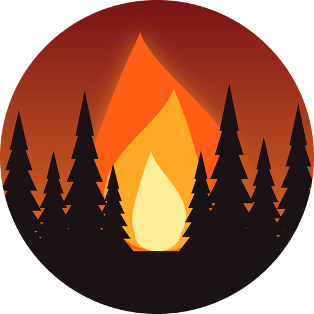

## Disclosure

This project was primarily created for personal use and for my family. While I may provide updates, they are not guaranteed. However, if you've stumbled upon this and find it interesting, feel free to download and use it. I had a great time building this and hope you enjoy it.

Note: Built with the assistance of Claude.ai. I’m putting it here now so you don't have to hunt for it below.

---



# Canadian Wildland Fire Information System (CWFIS) for Home Assistant

A custom Home Assistant integration that brings Canada's national wildfire data into Home Assistant: the national fire summary, active fires on a map, how close fires are to you, alerts when something changes near you, and whether wildfire smoke is likely to reach you.

It works anywhere. You don't need to live in Canada; smoke from Canadian fires regularly reaches the northern United States, which is why this was built.

> [!WARNING]
> This is a hobby project, not an emergency alert system. Data can be delayed, incomplete or wrong. For evacuation orders and safety decisions, always follow your local authorities and official fire agency sources.

## Contents

- [Features](#features)
- [Requirements](#requirements)
- [Installation](#installation)
- [Setup and configuration](#setup-and-configuration)
- [Entities](#entities)
- [Using it](#using-it)
- [How the numbers work](#how-the-numbers-work)
- [Troubleshooting and known issues](#troubleshooting-and-known-issues)
- [Maintaining this project](#maintaining-this-project)
- [Credits and data licences](#credits-and-data-licences)
- [Licence](#licence)

## Features

- **National summary**, matching the CWFIS homepage: fires reported today, active, out, total and area burned this season.
- **Season comparison**: fires and area burned versus the same moment last year.
- **Per-province breakdown**, with optional dedicated sensors for the provinces you care about.
- **Proximity to Home**, plus any extra zones you choose (a cottage, family, a trip): nearest active fire, fires inside your alert radius, nearest satellite fire perimeter, satellite hotspots (last 24 h), prescribed burns and the local fire danger rating.
- **Fire alert events**: a new fire inside your radius, a stage-of-control change, significant growth, or a fire declared out.
- **Smoke**: a 24/48-hour PM2.5 forecast for Home, a "fire upwind" indicator using your own wind sensor, and a "wildfire smoke" indicator that combines your own PM2.5 sensor with nearby fire sources.
- **Map**: one marker per active fire for the built-in Map card, and/or Canada-wide map images (fire danger today and tomorrow, smoke, hotspots).
- Everything is set up through the UI. There's no YAML, no extra Python packages and no API keys.

## Requirements

- Home Assistant **2026.3 or newer** (needed for the integration's built-in icon). Developed and tested on Core 2026.9.4.
- Internet access to `geoserver.cwfif.nrcan.gc.ca`, `cwfis.cfs.nrcan.gc.ca` and `air-quality-api.open-meteo.com`.

## Installation

### Manual

1. Download this repository (green **Code** button → **Download ZIP**).
2. Copy the `custom_components/cwfis` folder into your Home Assistant `config/custom_components/` folder, so you end up with `config/custom_components/cwfis/manifest.json`.
3. Restart Home Assistant.

### HACS (custom repository)

1. In HACS, open the menu → **Custom repositories**.
2. Add `https://github.com/soullink9/HomeAssistant-Canadian_Wildland_Fire_Information_System_-CWFIS-` with the type **Integration**.
3. Install **Canadian Wildland Fire Information System**, then restart Home Assistant.

## Setup and configuration

1. Go to **Settings → Devices & services → Add integration** and search for **Canadian Wildland Fire Information System**.
2. Setup takes a single click. It uses your Home Assistant **Home** location.
3. To adjust anything, open the integration and select **Configure**. Saving reloads the integration automatically.

| Option | Default | What it does |
|---|---|---|
| Alert radius | 250 km | Agency-reported fires within this distance of a zone count as "nearby" and raise Fire alert events. Hotspots, perimeters and prescribed burns are counted within this distance too. |
| Extra watch zones | none | Any of your Home Assistant zones. Each one gets its own set of proximity sensors. Home is always included. |
| Smoke radius | 1000 km | How far away a fire can be and still count as a possible smoke source. |
| Wind direction sensor | none | A sensor reporting the direction the wind blows **from**, in degrees (most weather stations report it this way). Enables **Fire upwind**. |
| PM2.5 sensor | none | An air-quality PM2.5 sensor, for example from the built-in AirNow or PurpleAir integrations. Enables **Wildfire smoke**. |
| PM2.5 smoke threshold | 35 µg/m³ | PM2.5 at or above this counts as smoky. 35 µg/m³ is the US EPA 24-hour standard. |
| Province sensors | none | Adds **Active fires** and **Area burned** sensors for each agency picked. |
| Fires on map | All active fires | Which fires get a map marker: all, only those inside an alert radius, or none. |
| Map images | none | Canada-wide map pictures to add as image entities. |

**Choosing the radii.** Pick distances that suit where you live. For example, from southern New England, Montreal is about 440 km away and central Quebec's fire belt 900–1,400 km, so an alert radius of about 600 km and a smoke radius of about 1,500 km work well there.

## Entities

Everything belongs to one device called **CWFIS**. Entity IDs follow the names, for example `sensor.cwfis_active_fires`. Sensors for extra zones and provinces have the zone or province name added, for example `sensor.cwfis_nearest_active_fire_cottage` or `sensor.cwfis_active_fires_quebec`.

### National sensors

| Name | Unit | Notes |
|---|---|---|
| Reported today | fires | This season's fires first reported since local midnight. |
| Active fires | fires | Every fire not yet declared out. Attributes: counts by stage of control and by province. |
| Out fires | fires | This season's fires declared out. |
| Total fires | fires | All fires this season. |
| Area burned | ha | This season's total. Attributes: area by province. |
| Fires vs last year | % | Total fires compared with the same moment last year. Attributes give both numbers. |
| Area burned vs last year | % | Area burned compared with the same moment last year. |
| Smoke forecast PM2.5 (24h max) | µg/m³ | Highest forecast PM2.5 at Home in the next 24 h. Attributes: peak time, 48-hour max and its time. |

### Per-zone sensors (Home and each extra zone)

| Name | Unit | Notes |
|---|---|---|
| Nearest active fire | km | Attributes: fire ID, agency, stage, size, direction from the zone, last update. |
| Active fires nearby | fires | Fires inside the alert radius, listed in the attributes (up to 20). |
| Nearest fire perimeter | km | Distance to the closest satellite-estimated fire edge found around the zone (searched out to roughly the alert radius). |
| Hotspots nearby (24h) | hotspots | Satellite heat detections inside the alert radius. These often show a new fire before it's reported. |
| Prescribed burns nearby | burns | Planned burns inside the alert radius. |
| Fire danger | text | Low, Moderate, High, Very high or Extreme. Only available for locations inside Canada. |

Distance sensors show in miles automatically if Home Assistant uses US units. Attributes are always in km.

### Province sensors (optional)

**Active fires** and **Area burned** for each agency picked under Configure.

### Binary sensors

| Name | When it's on |
|---|---|
| Fire within alert radius (one per zone) | An agency-reported active fire is inside that zone's alert radius. Attributes: radius, count, nearest fire and its distance. |
| Fire upwind (needs a wind sensor) | A fire within the smoke radius lies within ±45° of the direction the wind is blowing from. |
| Wildfire smoke (needs a PM2.5 sensor) | Your measured PM2.5 is at or above the threshold **and** a likely fire source exists: an upwind fire if a wind sensor is set, otherwise any fire within the smoke radius. |

### Fire alert event

`event.cwfis_fire_alert` fires one of these event types for any fire inside any zone's alert radius:

| Event type | When |
|---|---|
| New fire nearby | A fire appears inside the radius. |
| Stage changed | Its stage of control changes. Includes the previous stage. |
| Fire grew | It has grown by 25 % and at least 10 ha since the last alert. |
| Fire out | It's declared out. |

Every event carries the zone, fire ID, agency, stage, size, distance and direction. An event entity's state is the time of its last event, so it shows **Unknown** until the first event fires. That's normal.

### Map markers

`geo_location.cwfis_<agency>_<fire>`, for example `geo_location.cwfis_bc_k71668`. These are created and removed automatically as fires start and go out.

### Map images (optional)

| Name | Shows |
|---|---|
| Fire danger map | Today's fire danger across Canada. |
| Fire danger forecast map (tomorrow) | Tomorrow's forecast fire danger. |
| Smoke map | Surface smoke (PM2.5). |
| Hotspots map (24h) | Satellite hotspots from the last 24 hours. |

## Using it

### Dashboard

A summary plus a map of active fires, using only built-in cards:

```yaml
type: vertical-stack
cards:
  - type: glance
    title: Canadian Wildland Fires
    entities:
      - sensor.cwfis_reported_today
      - sensor.cwfis_active_fires
      - sensor.cwfis_out_fires
      - sensor.cwfis_total_fires
      - sensor.cwfis_area_burned
  - type: map
    geo_location_sources:
      - cwfis
    default_zoom: 3
```

To show a map image, add a **Picture entity** card and pick, for example, `image.cwfis_fire_danger_map`. A **Logbook** card on `event.cwfis_fire_alert` gives a history of alerts.

### Notifications

In **Settings → Automations → Create automation**:

1. **Trigger:** Entity → State, entity **CWFIS Fire alert**, with "from" and "to" left empty.
2. **Condition (optional):** Entity → State on the same entity, attribute **Event type**, if you only want some event types.
3. **Action:** your notify action, with a message such as:

```text
{{ trigger.to_state.attributes.event_type }} – {{ trigger.to_state.attributes.fire }},
{{ trigger.to_state.attributes.distance_km }} km {{ trigger.to_state.attributes.direction }}
```

Other useful triggers: **Smoke forecast PM2.5** going above 35 ("close the windows tomorrow"), or **Wildfire smoke** turning on.

## How the numbers work

- **Updates:** all data refreshes every 30 minutes. CWFIS itself updates hourly. Map images download only when viewed.
- **Season numbers** (reported today, out, total, area burned and the province areas) count fires from the current calendar year, like the CWFIS homepage.
- **Active fires** also includes fires from an earlier season that are still burning, so fires that carry over New Year keep being tracked. For a while after New Year, Active + Out can therefore be more than Total.
- **Reported today:** fires that weren't in the data at local midnight.
- **Distances** are straight-line distances to each fire's reported location. **Nearest fire perimeter** measures to the closest corner of the satellite-estimated perimeter shape, so it can read slightly long for big fires.
- **Fire upwind** uses ground-level wind from your own station. Smoke often travels at altitude on different winds, so treat it as a heads-up rather than a forecast.
- **Smoke forecast** is total PM2.5 (all sources, not only smoke) from the ECMWF CAMS model via Open-Meteo. Ordinary days usually sit around 5–15 µg/m³; real smoke events go well above 35.
- **Last-year comparison:** season totals exactly as they stood at this moment last year (on Feb 29 it compares with Feb 28). It's fetched once a day.
- **Province sensors** cover all CWFIS reporting agencies: the provinces, the territories and Parks Canada.

## Troubleshooting and known issues

- **Turning on debug logging:** **Settings → Devices & services → Canadian Wildland Fire Information System → ⋮ → Enable debug logging**, then check **Settings → System → Logs**.
- **A sensor shows Unknown:** that optional data source didn't answer during the last update. Everything else keeps working, and it retries every 30 minutes.
- **Smoke map image is blank:** as of October 2026 the CWFIS server returns "Internal error" for its smoke layer. The integration logs one warning and recovers automatically once CWFIS fixes it. The PM2.5 forecast and Wildfire smoke sensors still work.
- **Legacy CWFIS server:** hotspots, perimeters, fire danger and the map images come from CWFIS's older server, which Natural Resources Canada plans to migrate. If those start failing permanently, the URLs and layer names in `const.py` are the only things that should need updating.

## Maintaining this project

### File structure

```text
.
├── README.md                     this file
├── CHANGELOG.md                  what changed in each release
├── LICENSE                       MIT licence
├── hacs.json                     lets HACS install from this repository
├── .github/workflows/validate.yml  runs the checks below on every push
├── tests/
│   └── simulate.py               offline simulation of the integration (see below)
└── custom_components/cwfis/
    ├── __init__.py               setup/unload, and a map of the other files
    ├── manifest.json             integration metadata and version number
    ├── const.py                  URLs, layer names, option keys, defaults, lookup tables
    ├── helpers.py                small pure functions (distance, bearing, data clean-up)
    ├── coordinator.py            fetches all data once per update and does the calculations
    ├── entity.py                 base entity: shared device, naming and availability
    ├── sensor.py                 all sensors
    ├── binary_sensor.py          Fire within alert radius, Fire upwind, Wildfire smoke
    ├── event.py                  Fire alert event entity
    ├── geo_location.py           map markers
    ├── image.py                  map images
    ├── config_flow.py            setup and the Configure form
    ├── translations/en.json      UI text for the Configure form and event types
    └── brand/                    integration icon shown in Home Assistant
```

**Where to start:** everything entities show comes from the dict built in `CwfisCoordinator._async_update_data` (`coordinator.py`). The entity files only read from it.

### Testing

```bash
python3 tests/simulate.py
```

This runs the integration against fake server data in plain Python. No Home Assistant install or internet access is needed. It covers a normal day, New Year rollover, an empty off-season, messy or incomplete data, sources being down, leap day and every alert type, and checks that entity unique IDs never change. Add a scenario whenever a real data problem turns up.

### Releasing a new version

1. Make your changes and run `python3 tests/simulate.py`.
2. Bump `version` in `custom_components/cwfis/manifest.json`. Use `1.0.1` for fixes, `1.1.0` for new features, and `2.0.0` for anything that changes entity IDs or removes features.
3. Add an entry to `CHANGELOG.md`.
4. Commit, then create a GitHub release tagged `v<version>`, for example `v1.0.1`. HACS offers releases as updates.

The **Validate** GitHub Action runs the simulation, Home Assistant's `hassfest` check and the HACS check on every push.

## Credits and data licences

**Data**

- **Canadian Wildland Fire Information System (CWFIS)** and the **Canadian Wildland Fire Information Framework (CWFIF)**, Natural Resources Canada, Canadian Forest Service: reported and prescribed fires, satellite hotspots, fire perimeter estimates, fire danger and map images. *Contains information licensed under the [Open Government Licence – Canada](https://open.canada.ca/en/open-government-licence-canada).* Data access follows NRCan's guide [How to Access CWFIS Data Services](https://cwfis.cfs.nrcan.gc.ca/downloads/docs/en/how-tos/how-to-access-cwfis-data-services.pdf).
- **[Open-Meteo](https://open-meteo.com/)**: air-quality forecast API, data licensed under [CC BY 4.0](https://creativecommons.org/licenses/by/4.0/). Air-quality forecast data by Open-Meteo.com.
- **Copernicus Atmosphere Monitoring Service (CAMS)**, ECMWF: the PM2.5 forecast model behind the Open-Meteo data. Generated using Copernicus Atmosphere Monitoring Service information.

**Code**

- No third-party code is included. The integration follows the patterns in the [Home Assistant developer documentation](https://developers.home-assistant.io/) (data update coordinator, options flow, geo-location and event entities, and [custom integration brand images](https://developers.home-assistant.io/blog/2026/02/24/brands-proxy-api)).
- Distances use Home Assistant's built-in location helper. Compass bearings use the standard forward-azimuth formula.
- Built with the assistance of [Claude](https://claude.ai) (Anthropic).

**Icon:** original artwork made for this project.

This project is not affiliated with, endorsed by or supported by the Government of Canada, Natural Resources Canada, Open-Meteo or ECMWF.

## Licence

The code is released under the [MIT Licence](LICENSE). The data it retrieves stays under its providers' licences listed above.
